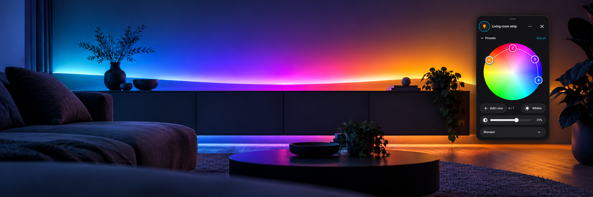

# Philips Hue Gradient Controller

<p align="center">
  <a href="https://github.com/berti24/hue-gradient-controller/releases/latest"></a>
  <a href="https://github.com/berti24/hue-gradient-controller/actions/workflows/tests.yml"></a>
  <a href="https://github.com/berti24/hue-gradient-controller/blob/main/LICENSE"></a>
</p>

<p align="center">
  
</p>

Home Assistant integration that adds gradient controls to the light entities
created by HA's native Philips Hue integration.

The integration adds live gradient state attributes to compatible Hue lights
and registers actions to set, snapshot, and restore gradient state in scripts
and automations.

The integration also adds a [light card](hue-gradient-light-card/README.md) that is capable of controlling the created gradient attributes from the dashboard.

## Requirements

- Home Assistant 2026.7 or newer
- Home Assistant's native Philips Hue integration with at least 1 active bridge
- A Hue light with the `gradient` feature

## Installation

### HACS custom repository

[](https://my.home-assistant.io/redirect/hacs_repository/?owner=berti24&repository=hue-gradient-controller&category=integration)

1. Open HACS.
2. Add `https://github.com/berti24/hue-gradient-controller` as a custom
   repository of type **Integration**.
3. Install **Philips Hue Gradient Controller**.
4. Restart Home Assistant.

After restarting, use this shortcut or follow steps 5–6 below to open the
integration setup flow:

[](https://my.home-assistant.io/redirect/config_flow_start/?domain=hue_gradient_controller)

5. Open **Settings → Devices & services → Add integration** and select
   **Philips Hue Gradient Controller**.
6. Select one or more configured Hue v2 bridges, or select **All Hue bridges**.

After choosing the bridges, the Add and Configure flows show a read-only,
grouped summary of the native Hue lights that currently receive gradient
attributes. The summary is calculated from existing entities and does not
create or reassign entities or devices.

One config entry stores the bridge selection. The selection can be changed
later with **Configure** on the integration. **All Hue bridges** also covers bridges added in the future.

### Manual

Copy `custom_components/hue_gradient_controller` into the matching
`custom_components` directory in your Home Assistant configuration, restart,
and add the integration from the UI.

## Added light attributes

Native Hue light entities with a gradient feature on a selected bridge receive these attributes in Home Assistant's entity Details view:

| Attribute | Meaning |
| --- | --- |
| `gradient_capable` | Always `true` on a supported light |
| `gradient_colors` | Ordered current colors as `#RRGGBB` |
| `gradient_colors_rgb` | Ordered current colors as `[R, G, B]` |
| `gradient_colors_xy` | Exact ordered Hue CIE xy values |
| `gradient_mode` | Current Hue gradient mode |
| `gradient_modes` | Modes reported as supported by this light |
| `gradient_points_capable` | Maximum color points reported by this light |
| `gradient_pixel_count` | Physical pixel count, when Hue reports it |

Home Assistant's native Hue `mode` and `dynamics` attributes are preserved.
RGB and hex display values use Home Assistant's conversion with the light's
reported color gamut. `gradient_colors_xy` remains the exact bridge state.

Changes made in the Hue app or by another Hue client flow through the native
Hue event stream and refresh the same Home Assistant light entity, including
its gradient points and mode. If the event stream reconnects, aiohue compares a
fresh full bridge state so changes missed while disconnected are recovered.
These attributes represent the latest state reported by the bridge; they are
not per-frame telemetry for Hue Entertainment streaming.

## Gradient presets

The optional dashboard editor includes a collapsible, swipeable preset carousel
and a **See all** library view. Twenty built-in palettes contain two through five
colors, including four GTA VI palettes inspired by Vice City and Leonida, two
Halloween palettes, and two Christmas palettes.
**Save current** captures exact live Hue xy points and mode; custom presets are
shared across Home Assistant devices and cards. Favorites are personal, appear
first, and are not added automatically when saving. See the
[card documentation](hue-gradient-light-card/README.md#gradient-presets) for controls.

Creators and administrators can update, rename, and delete custom presets.
Each built-in palette includes a suggested brightness tuned to its mood; its
percentage appears below the preview and is applied with the gradient. Custom
presets keep the current brightness and can be reused on other selected native
gradient lights with sufficient capacity and support for their mode. Exact xy
values are sent unchanged, though different light hardware may produce different
colors. This is a color recipe, separate from the entity-bound snapshot/restore
actions.

```yaml
action: hue_gradient_controller.apply_preset
target:
  entity_id: light.hue_gradient_floor
data:
  preset_id: builtin:sunset
  transition: 0.5
  turn_on: true
```

`turn_on` defaults to true. Built-in presets apply their suggested brightness;
custom preset IDs leave brightness unchanged. Custom preset IDs are returned
when saving and appear in authenticated library messages.
Optional action response data contains `applied` (including expected xy points
and mode) and target-specific `skipped` reasons. Normal target authorization,
bridge selection, sequential writes, and best-effort behavior apply.

## Set a gradient

The visual action editor provides repeatable RGB color-picker rows. In YAML,
all colors in one action call must use the same representation: strict
`#RRGGBB` strings or RGB triples. `mode` defaults to `interpolated_palette`.

```yaml
action: hue_gradient_controller.set_gradient
target:
  entity_id: light.hue_gradient_floor
data:
  colors:
    - "#FF3B30"
    - "#AF52DE"
    - "#007AFF"
  mode: segmented_palette
  turn_on: true
  brightness: 180
  transition: 1.5
```

The equivalent RGB form is:

```yaml
action: hue_gradient_controller.set_gradient
target:
  entity_id: light.hue_gradient_floor
data:
  colors:
    - [255, 59, 48]
    - [175, 82, 222]
    - [0, 122, 255]
```

Supported modes are reported per entity. With the current Hue API they can
include:

- `interpolated_palette`
- `interpolated_palette_mirrored`
- `random_pixelated`
- `segmented_palette`

A one-color call uses the normal Hue color field and ignores `mode`. It still
targets a gradient-capable individual Hue light. `turn_on` defaults to `false`;
when false, the integration does not explicitly change the on/off field.

For multiple targets, processing is best effort. Lights on unselected bridges
and incompatible, unavailable, grouped, non-Hue, over-capacity, or
mode-incompatible targets are logged and skipped while compatible lights
continue. Values are never clamped and modes are never silently substituted.
Input validation and authorization complete before the first bridge write.

## Snapshot and restore exact state

`snapshot_gradient` returns a versioned response containing each eligible
light's exact Hue xy gradient points, mode, power state, and bridge-level
brightness. `restore_gradient` consumes that response and writes the xy points
without converting them through RGB, so the round trip is lossless.

```yaml
sequence:
  - action: hue_gradient_controller.snapshot_gradient
    target:
      entity_id:
        - light.hue_gradient_floor
        - light.hue_gradient_table
    response_variable: saved_gradient
  - action: hue_gradient_controller.set_gradient
    target:
      entity_id:
        - light.hue_gradient_floor
        - light.hue_gradient_table
    data:
      colors: ["#FF9500", "#AF52DE", "#007AFF"]
      turn_on: true
  # Other actions can run here before the exact state is restored.
  - action: hue_gradient_controller.restore_gradient
    data:
      snapshot: "{{ saved_gradient }}"
      transition: 1
```

The snapshot response contains an `entities` mapping and a `skipped` mapping
with stable reason codes for ineligible targets. Snapshot requires read access
to every resolved target. Restore takes its targets from the snapshot, requires
control access to all of them before the first write, and then follows the same
sequential best-effort behavior as `set_gradient`. Snapshot payload version `1`
requires at least two exact xy points per entity.

## Scripts and scenes

The action is designed for Home Assistant scripts and automations. For a
scene-like preset, put the normal scene activation and gradient action in a
script:

```yaml
alias: Sunset gradient preset
sequence:
  - action: scene.turn_on
    target:
      entity_id: scene.living_room_sunset
  - action: hue_gradient_controller.set_gradient
    target:
      entity_id: light.hue_gradient_floor
    data:
      colors: ["#FF9500", "#FF2D55", "#5856D6"]
      mode: interpolated_palette
```

Home Assistant's built-in scene snapshot/restore path does not automatically
replay custom gradient attributes. Scripts can use `snapshot_gradient` and
`restore_gradient` around temporary changes without creating shadow entities or
patching broad Home Assistant scene behavior.

## Diagnostics and Repairs

The integration provides downloadable config-entry diagnostics for support.
They report bridge-selection counts and native Hue light capabilities while
redacting bridge titles, config-entry IDs, entity IDs, credentials, hosts, and
live color state.

Home Assistant Repairs reports an error if the guarded native Hue attribute
hook is incompatible and a warning if an explicitly selected Hue v2 bridge is
disabled, removed, ignored, or no longer uses API v2. Selection warnings update
when native Hue entries change and clear when the selected bridges become
eligible again; integration-owned issues are removed on unload.
Persistent issues are also removed if the integration config entry is deleted.

## Compatibility and privacy

The integration reuses the loaded native Hue bridge, controller, resource, and
entity objects. A narrow compatibility hook extends only the native
`HueLight.extra_state_attributes` property and is restored on unload. The
integration fails setup if that property no longer has the expected shape,
rather than applying a broad or unsafe patch.

No Hue application key is copied or stored. No additional connection to a Hue
bridge is opened.

## Dashboard card and compact gradient popup

The optional **Hue Gradient Light** card wraps the original Home Assistant Tile
or Bubble light button and opens a compact color/white-tone gradient wheel.
It also supports ordinary light entities without the Python integration.
**Hue Gradient Editor** can be embedded in original Bubble hash-linked popups.
Both cards have visual configuration editors.
Enable **Protect while off** (`protect_when_off: true`) on a light card or editor
to require an explicit Turn on before changing an off light. It defaults to
false. On touch screens, hold the wheel or a point briefly to edit colors;
ordinary swipes scroll without changing the palette.

The built frontend asset ships with this Integration; copying it to `/config/www`
and registering a dashboard resource is a separate one-time frontend step.
See [dashboard installation, configuration, Bubble examples and themes](hue-gradient-light-card/README.md).

```yaml
type: custom:hue-gradient-light-card
entity: light.living_room_strip
```

## Development

```bash
uv sync --python 3.14.2
.venv/bin/pytest
.venv/bin/ruff check custom_components tests scripts
```

Architecture decisions are recorded in [`docs/adr`](docs/adr), and terminology
is defined in [`docs/glossary.md`](docs/glossary.md). Releases follow Semantic
Versioning and are recorded in [`CHANGELOG.md`](CHANGELOG.md). HACS displays the
version from the integration manifest.
