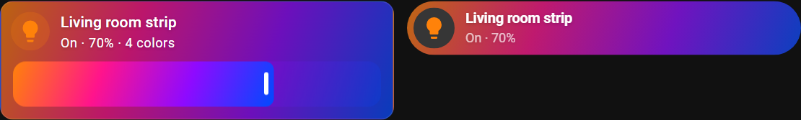
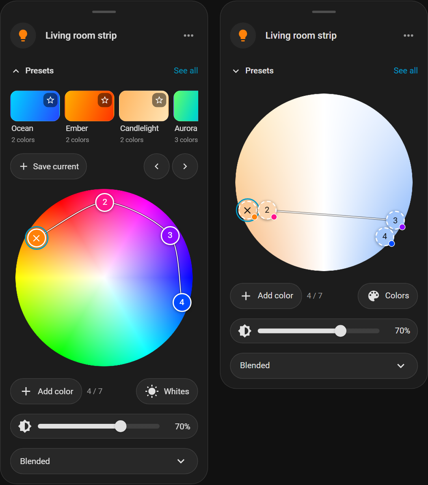
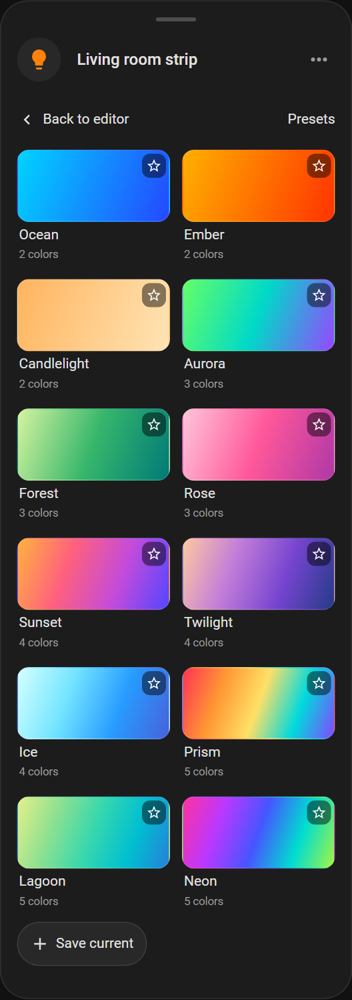
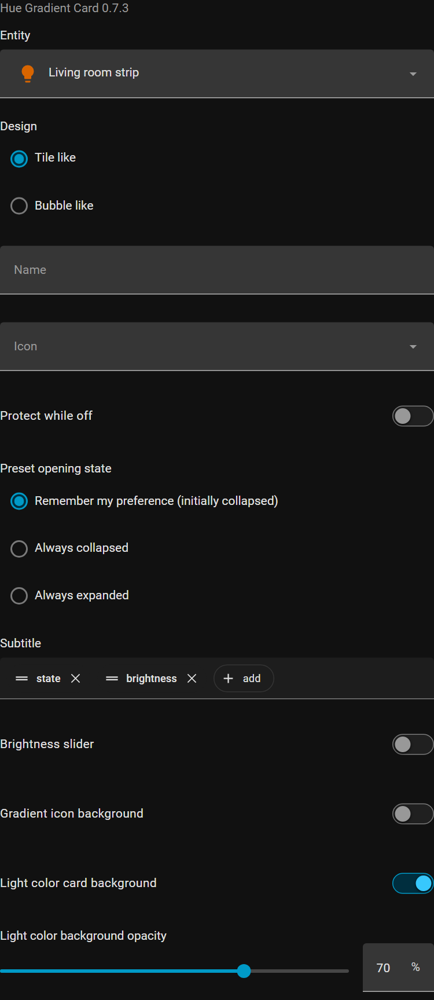

<p align="center">
  
</p>

# Hue Gradient Light Card

Bring your Hue gradients onto your Home Assistant dashboard. See your light's
colors at a glance, open a color wheel to shape each stop, and save favorite
combinations for next time.

## Install with HACS

You can install through HACS even before this repository appears in its default
catalogue. With [HACS installed](https://www.hacs.xyz/docs/use/), follow its
[custom repository workflow](https://www.hacs.xyz/docs/faq/custom_repositories/):

1. Open **HACS → three-dot menu → Custom repositories**.
2. Add `https://github.com/berti24/hue-gradient-controller`, select
   **Integration** as the type, and click **Add**.
3. Find **Philips Hue Gradient Controller** in HACS and download it.
4. Restart Home Assistant. Make sure the built-in **Philips Hue** integration
   already has your bridge and lights configured, then go to
   **Settings → Devices & services → Add integration → Philips Hue Gradient
   Controller** and select the bridges you want to control.
5. Install the dashboard resource using the steps below. HACS downloads the
   integration and its bundled card; the card still needs a file copy and
   resource registration.

See the [integration README](../README.md) for supported lights, bridge setup,
actions and exact gradient snapshots.

## Install the dashboard card

The card controls any existing `light.*` entity. Hue gradients
require this integration, an available individual native Hue gradient light on
a selected bridge, valid capacity and supported modes, and the gradient actions.
Ordinary light power, brightness, RGB and temperature use native light services.

For manual installation, copy `custom_components/hue_gradient_controller` to
`/config/custom_components/`, restart Home Assistant, and add the integration
as described above. Then, for either installation method:

1. Copy `custom_components/hue_gradient_controller/www/hue-gradient-light-card.js`
   from the installed integration to `/config/www/hue-gradient-light-card.js`.
   The copy also works independently for ordinary lights without loading the
   Python integration.
2. Enable Advanced mode in your profile. Open **Settings → Dashboards →
   three-dot menu → Resources → Add resource**. Enter
   `/local/hue-gradient-light-card.js?v=0.7.5` and choose **JavaScript module**.
   Use the installed release version when updating in the future.
3. Hard-refresh the browser/companion app frontend. Add a card and search for
   **Hue Gradient Light** or **Hue Gradient Editor**.
4. For the Bubble design, install **Bubble Card** through HACS and load its
   resource. Without Bubble the card renders a Tile; its editor explains the
   missing dependency and keeps the saved design.

On every update, repeat the file copy, update the resource URL's version query,
and refresh each client. HACS installs the shipped asset but does not copy it to
`www` or register the resource. Do not add this Integration repository a second
time as a HACS Dashboard repository. No CDN, browser_mod, or frontend runtime
npm dependencies are needed after building.

For YAML-managed dashboard resources:

```yaml
lovelace:
  resources:
    - url: /local/hue-gradient-light-card.js?v=0.7.5
      type: module
```

## Features at a glance

- **Two dashboard designs:** native Tile or Bubble styling, with live light-color
  backgrounds and an optional gradient around the icon.
- **Direct light controls:** toggle power from the icon, open the editor from the
  card, and optionally add a gradient-filled brightness slider to Tile cards.
- **Multi-point editing:** drag individual gradient stops on the color wheel,
  add or remove colors up to the light's capacity, and choose a reported mode.
- **Colors and whites:** switch between a color wheel and a warm-to-cool RGB
  palette; ordinary temperature lights get their native Kelvin control.
- **Presets:** browse built-in palettes, star favorites, and save your own shared
  recipes. Favorites and opening preferences sync across authenticated devices.
- **Snapshot and restore:** keep an exact gradient snapshot through the editor's
  menu, including xy points, mode, power and brightness.
- **Flexible placement:** use the responsive card-owned popup or place the
  standalone editor on a dashboard or inside a Bubble popup.
- **Touch and keyboard controls:** hold to arm touch editing, use arrow keys to
  move points, and enable Protect while off to prevent accidental changes.

Ordinary light controls work with existing `light.*` entities. Gradient editing,
presets and exact snapshots require this integration and a selected, available,
individual native Hue gradient light. Bubble styling additionally requires
[Bubble Card](https://github.com/Clooos/Bubble-Card).

## Screenshots

These are screenshots of the actual card in the repository's browser compatibility
fixture, using native Home Assistant and Bubble renderers with simulated light
state. The hero combines a room illustration with the popup editor screenshot.
Appearance follows your HA theme.

**Tile with brightness slider (left) and Bubble (right)**



**Color wheel with presets (left) and the Whites palette (right)**



Whites edits the same RGB stops. Colored stops retain their original color until
moved; the small swatches identify colors outside the white palette.

**Preset library**



**Visual settings**

<details>
<summary>Show the card configuration editor</summary>



</details>

## Card configuration

Minimal configuration:

```yaml
type: custom:hue-gradient-light-card
entity: light.living_room_strip
```

All public card options are available in its visual editor:

The editor uses Tile's collapsible **Content**, **Interactions**, and **Features**
sections. Entity stays visible above them. Features is available for the Tile
design; Content holds appearance and subtitle settings, and Interactions holds
off-state protection and preset opening behavior.

| Field | YAML | Default |
| --- | --- | --- |
| Entity | `entity` | Required; any light entity |
| Design | `design` | `tile`; "Tile like" (`tile`) or "Bubble like" (`bubble`) |
| Preset opening state | `presets_expansion` | `remember`; synchronized preference, or `collapsed` / `expanded` |
| Name | `name` | Entity's displayed name |
| Icon | `icon` | Entity icon/native light fallback |
| Protect while off | `protect_when_off` | `false`; lock editing while the light is off |
| Subtitle | `state_content` | `['state', 'brightness']`; native Tile picker; supports ordered state/attribute names, `hgc_color_count`, `hgc_gradient_mode`; `[]` hides the line |
| Brightness slider | `show_brightness_slider` | `false`; Tile-like cards only, adds a native brightness control |
| Features position | `features_position` | `bottom`; `inline` puts brightness beside the name, in the right side of the first row; Tile-like cards only |
| Gradient icon background | `icon_gradient_background` | `false`; also supported by the standalone editor and forwarded to its popup |
| Light color card background | `color_background` | `true` |
| Light color background opacity | `color_background_opacity` | 70; number from 0 to 100 |

```yaml
type: custom:hue-gradient-light-card
entity: light.living_room_strip
design: bubble
name: Living room strip
icon: mdi:led-strip-variant
protect_when_off: true
state_content:
  - state
  - brightness
  - hgc_color_count
  - hgc_gradient_mode
color_background: true
icon_gradient_background: false
color_background_opacity: 70
```

Empty Name and Icon overrides are omitted from saved configuration. Config edits
emit `config-changed` and never send light commands. Home Assistant's standard
Sections Layout tab controls `grid_options`; it is passed through to the native
renderer. The card delegates masonry size and Sections grid rules. Tile and
Bubble use their original distinct footprints, padding, icon geometry and fonts.
The icon toggles power; the main card opens the compact editor.

Enable **Brightness slider** for the Tile-like design to add a second row:

```yaml
type: custom:hue-gradient-light-card
entity: light.living_room_strip
design: tile
show_brightness_slider: true
features_position: inline
```

The filled slider blends all current gradient colors, with a dimmed gradient
across the remaining track. It follows live color changes independently of the
card background option. Ordinary color/temperature lights use their current
color; lights without brightness support omit the feature. Native Tile handles
keyboard/touch interactions and dashboard sizing. In **Features**, choose **Below**
for the second row (the default), or **Inline** for Tile's slider beside the name,
using the space on the right. Adjusting brightness
turns an off light on by default; `protect_when_off: true` disables this slider
while off and discards unsent brightness requests on power-off. Unavailable
lights cannot send commands. Bubble keeps
its original layout and ignores this Tile-only option.

Both configuration editors show the version bundled in the loaded JavaScript.
The subtitle uses Home Assistant's native Tile option picker: add, remove and
reorder fields. Existing `show_state`, `show_brightness`, `show_color_count` and
`show_mode` YAML booleans still work when `state_content` is absent; an explicit
`state_content` takes precedence. Selecting no fields hides the line.
Brightness is hidden while off and omitted for lights without brightness
support. Color count follows the currently reported color/gradient appearance;
mode appears only for an eligible active multi-point gradient. Presentation
values are scoped to the owned native renderer and never published to HA state.

The light's color layer covers the native card surface by default; disable
`color_background` to keep the theme surface. This setting is independent of
`icon_gradient_background`, which blends all reported colors around the icon.
While on, the icon itself uses the first reported light color. Opacity 0 retains the
normal theme surface, 70 composites the light colors over it, and 100 shows full
colors. It never fades controls or the card itself. Off uses the theme surface;
unavailable/missing lights disable commands. No usable color data uses the native
light state-color theme fallback. RGB/hex gradient attributes are gamut-aware
display values; exact `gradient_colors_xy` is the reported gradient authority.

Native temperature state takes precedence over retained historical gradient
attributes. During a session, a native XY change with unchanged stops and mode
switches to a solid background; new gradient stops or a mode change switch back.
Derived RGB/HS updates do not suppress the palette, including in Pixelated mode.
Hue/HA expose no unambiguous active-gradient flag for a fresh frontend session
with stale unchanged stops. That initial ambiguity cannot be resolved from the
supplied state alone.

## Gradient presets

Selected native Hue gradient lights gain **Presets** above the wheel. The chevron
opens a carousel showing three complete previews and half the next preview. Swipe,
drag with a mouse, use the mouse wheel or trackpad, tab through presets, or use
Previous/Next buttons to browse. Tapping
a preview applies its colors and mode immediately, preserving brightness and the
current view. Swiping and starring never change the light.

**See all** opens the full preset grid inside the same editor; **Back to editor**
restores its previous carousel position. The confirmed active preset stays selected
when reopening an editor during the same authenticated browser session. Selection
keeps catalogue/favorite ordering and carousel position stable. Outside color/mode
changes clear the highlight when the reported palette no longer matches. Reloading
the browser starts a new session. Star a preset to show it before nonfavorites.
The built-in catalogue includes Ocean, Ember, Candlelight, Aurora, Forest, Rose,
Sunset, Twilight, Ice, Prism, Lagoon, and Neon, with two through five colors.
Presets needing more points or an unsupported mode remain visible with a reason.

**Save current** opens a name form and captures confirmed live xy points and mode,
without brightness or power. Pending/unconfirmed edits must settle first. Use
**Save new**, or **Update preset** after applying an editable custom preset. Library
rows expose Rename/Delete for creators and admins; deletion asks for confirmation
and removes that preset's favorites for everyone. Built-ins cannot be changed.
New presets are not automatically favorited.

The shared library and personal favorites/preferences are persisted locally by
Home Assistant and sync across cards and devices with authenticated push updates.
The preset feature requires the Python integration; ordinary frontend-only light
controls remain independent. Presets respect **Protect while off**; browsing and
favoriting remain available while the light is off.

The visual **Preset opening state** setting is also available in YAML:

```yaml
type: custom:hue-gradient-light-card
entity: light.living_room_strip
presets_expansion: remember
```

`remember` is the default, initially collapsed, then uses the user's synchronized
preference. `collapsed` and `expanded` set the opening state on each new editor;
manual toggles in these modes affect only that editor session. The option also
works with `custom:hue-gradient-editor`, including embedded editors.

## Compact popup controls

- The header uses Name/Icon; the icon controls power and shows the light's color
  while on. Brightness follows power changes immediately in both palette views.
  Escape, close or backdrop
  closes the card-owned modal. Opening or changing palette views never writes.
- The overflow menu gives transition, Snapshot and Restore their own rows, with
  More info last. More info opens HA's standard entity panel and closes the custom
  popup. While the menu is open, the rest of the editor is slightly blurred;
  clicking elsewhere on the editor or pressing Escape closes only the menu.
- Drag points on the filled hue/saturation wheel. Select an ordinal marker;
  activate the selected X to remove it. Dragging the X never removes the point.
  The final point has no X. Arrow keys move a focused point; Delete removes it;
  Enter/Space select or remove. The curves indicate point-list order only.
  Coincident marker targets initially separate slightly so each is reachable.
  During dragging, the selected marker follows the pointer continuously and
  neighboring markers keep their positions, including around neutral white.
- On touch screens, hold a point or the wheel background for about 400 ms to
  edit colors. A ring and **Ready to drag** hint show when editing is armed.
  Swiping before the hold completes scrolls the dashboard or popup without
  moving, recoloring or deleting points. Short background taps do not edit;
  short point taps select, or delete the selected X. Holding the X without
  moving does not delete it. Mouse dragging and keyboard editing stay immediate.
- Add color appends a point opposite the last color's hue on the color wheel.
  If that color is already used, it chooses the nearest unused color; neutral
  points start a saturated color. Capacity is reported by the
  light; Add disables at that maximum. Remaining points renumber immediately.
- Whites edits the **same** gradient list on a warm/neutral/cool RGB palette.
  It has no Kelvin claims. Off-palette points retain their actual color, have a
  white-tone marker face, a small actual-color swatch, a dashed border and an
  accessible description. Switching views does not convert them. Intentional
  dragging changes the selected point to the displayed palette and removes the
  off-palette swatch.
- Brightness applies immediately. Zero invokes `light.turn_off`; it is never
  sent to `set_gradient`. With the default `protect_when_off: false`, intentional
  color/brightness edits turn the light on.
- Enable **Protect while off** (`protect_when_off: true`) to keep the last
  reported palette visible but dimmed and lock color, point, mode, temperature,
  brightness and Restore controls while off. Use **Turn on** before editing;
  controls unlock only after HA reports on. Turning off immediately cancels
  gestures and unsent edits, including commands waiting in the shared entity
  queue; reported off updates do the same. Accepted requests cannot be recalled.
  Palette view switching, Snapshot and More info remain available without
  changing the light. This option belongs to each card/editor, not the light or
  the integration's service actions.
- The visually unlabeled dropdown has the accessible name **Gradient mode**.
  Its choices are only reported supported modes: Blended, Mirrored, Pixelated,
  Segments. It is disabled with one point. No unsupported mode is substituted.
  Its arrow shares the text's horizontal inset. The rounded list supports arrow
  keys, Home/End, letter navigation and Enter/Space; Escape closes only the list.
  The list also dismisses on outside taps and viewport/host scrolling.
- Overflow contains power, gradient transition (seconds), exact Snapshot and
  Restore. Snapshot requires a reported palette of at least two xy points.
  Restore appears only after a valid version-1 snapshot for that entity is
  captured. Snapshots are held only while that editor instance remains alive.

Ordinary color lights have one point and a white-tone RGB palette. Native
temperature lights have a Kelvin control bounded by their reported range.
Dimmable/on-off lights expose only supported controls. A gradient light always
uses RGB gradient stops for Whites; it does not use whole-light Kelvin commands.

Drag writes coalesce at approximately 120 ms and serialize per entity across
card instances. Release flushes the final value. Errors show an accessible
message and restore reported state. While editing, intermediate echoes do not
move the markers. Local feedback reconciles to latest `hass` state after an event
delivery allowance (or transition plus allowance). Backend best-effort skips
cannot be identified from response-less writes; the reported state remains the
authority. Disconnect cancels unsent work, not service calls already accepted.

## Embed inside an original Bubble popup

The editor has its own visual editor with Entity, Name, Icon, Protect while off,
Embedded and Card background. The
`embedded` boolean (default false) omits the popup close control and
inherits the host surface. The light icon, circular icon background, title,
power control and overflow remain visible. The editor also exposes
`icon_gradient_background` (default false) in YAML and its visual editor.
`protect_when_off` defaults to false here too; enable it independently on an
embedded editor to lock edits while off and keep explicit power controls usable.

Enable **Card background** (`card_background: true`) to give an embedded editor
its own theme surface, border, shadow and padding on a dashboard. Set it to
`false` for a transparent editor. When omitted, it defaults to `true` for a
standalone editor and `false` when `embedded: true`, preserving existing layouts.

Card-owned popups default to 560px wide on desktop (viewports at least 768px)
and keep their 352px default on mobile, always fitting within the viewport with
at least 24px of total horizontal clearance. Standalone dashboard editors fill
the width assigned by the dashboard, including Sections column settings. Neither
placement has a decorative grab handle; the light title and controls remain at
the top.

```yaml
type: custom:hue-gradient-editor
entity: light.living_room_strip
embedded: true
card_background: true
```

Bubble **v3.2.0+** supports standalone `cards:` content. This installation has
Bubble v3.4.1; the compatibility fixture uses the published original asset.
Place both cards in the same view:

```yaml
type: custom:bubble-card
card_type: button
button_type: switch
entity: light.living_room_strip
button_action:
  tap_action:
    action: navigate
    navigation_path: '#living-room-gradient'
```

```yaml
type: custom:bubble-card
card_type: pop-up
hash: '#living-room-gradient'
entity: light.living_room_strip
name: Living room strip
cards:
  - type: custom:hue-gradient-editor
    entity: light.living_room_strip
    embedded: true
```

For **Bubble v2.3.4**, use the original vertical-stack popup format (not `cards:`):

```yaml
type: vertical-stack
cards:
  - type: custom:bubble-card
    card_type: pop-up
    hash: '#living-room-gradient'
    entity: light.living_room_strip
    name: Living room strip
  - type: custom:hue-gradient-editor
    entity: light.living_room_strip
    embedded: true
```

Use the same navigation button above. These routes use Bubble's documented
hash navigation, without intercepting global more-info or needing browser_mod.

## Theme overrides

Native Tile/Bubble radii, dimensions and type styles remain native. The editor
inherits HA/Bubble theme values dynamically. Editor properties can be overridden
in HA themes (omit the leading `--` in theme YAML):

| CSS custom property | Default/fallback |
| --- | --- |
| `--hgc-surface` | HA card background |
| `--hgc-control-surface`, `--hgc-icon-surface` | HA secondary background |
| `--hgc-text-color`, `--hgc-secondary-text-color` | HA primary/secondary text |
| `--hgc-border-color`, `--hgc-border-width` | HA divider, 1px |
| `--hgc-control-border-width` | 1px |
| `--hgc-shadow` | HA card shadow |
| `--hgc-popup-radius` | Bubble popup radius → HA card radius → 28px |
| `--hgc-control-radius` | Bubble button radius → Bubble radius → HA large radius → 24px |
| `--hgc-popup-width`, `--hgc-wheel-size` | 560px desktop / 352px mobile (popup only), 300px |
| `--hgc-padding`, `--hgc-spacing` | 16px |
| `--hgc-embedded-padding`, `--hgc-embedded-tools-margin` | 0px, 4px |
| `--hgc-font-family`, `--hgc-font-size`, `--hgc-line-height` | HA font, 14px, 1.4 |
| `--hgc-title-size`, `--hgc-title-weight`, `--hgc-count-font-size` | HA large font, 500, 13px |
| `--hgc-icon-size`, `--hgc-header-icon-size`, `--hgc-icon-padding` | 24px, 40px, 6px |
| `--hgc-control-height`, `--hgc-touch-target` | 44px |
| `--hgc-point-size`, `--hgc-point-font-size`, `--hgc-point-icon-size` | 32px, 14px, 19px |
| `--hgc-point-border-color`, `--hgc-point-border-width`, `--hgc-point-shadow` | White, 2px, spectrum contrast shadow |
| `--hgc-selected-color`, `--hgc-selected-width`, `--hgc-selected-offset` | HA primary, 2px, 2px |
| `--hgc-point-dark-text`, `--hgc-point-light-text` | Spectrum contrast dark/light |
| `--hgc-point-swatch-size`, `--hgc-point-swatch-offset`, `--hgc-point-swatch-border-width` | 11px, -3px, 1px |
| `--hgc-connector-color`, `--hgc-connector-shadow` | Spectrum contrast white/dark |
| `--hgc-connector-width`, `--hgc-connector-shadow-width` | .75px, 1.7px in a 100-unit disc |
| `--hgc-slider-accent`, `--hgc-slider-padding`, `--hgc-output-width` | HA primary, 8px 12px, 42px |
| `--hgc-slider-fill`, `--hgc-slider-thumb`, `--hgc-slider-track` | HA primary text, primary text, divider |
| `--hgc-slider-track-height`, `--hgc-slider-thumb-size`, `--hgc-slider-thumb-shadow` | 8px, 20px, subtle thumb shadow |
| `--hgc-button-gap`, `--hgc-row-gap`, `--hgc-button-padding` | 8px, 8px, 8px 14px |
| `--hgc-select-padding`, `--hgc-wheel-margin` | 8px 16px, 8px auto 20px |
| `--hgc-mode-menu-radius`, `--hgc-mode-option-radius` | Control radius |
| `--hgc-mode-menu-gap`, `--hgc-mode-menu-viewport-padding`, `--hgc-mode-menu-padding` | 8px, 8px, 6px |
| `--hgc-mode-menu-max-height`, `--hgc-mode-menu-shadow` | 240px, HA card shadow or subtle raised shadow |
| `--hgc-mode-option-active` | HA card background |
| `--hgc-focus-color`, `--hgc-focus-width`, `--hgc-focus-offset` | HA primary, 3px, 3px |
| `--hgc-disabled-opacity`, `--hgc-error-color` | .45, HA error |
| `--hgc-menu-gap`, `--hgc-menu-padding`, `--hgc-menu-summary-padding` | 8px, 8px, 4px |
| `--hgc-menu-top` | 70px |
| `--hgc-transition-width`, `--hgc-input-radius`, `--hgc-input-padding` | 80px, 8px, 6px |
| `--hgc-status-margin`, `--hgc-embedded-tools-margin` | 8px 0, 4px |
| `--hgc-backdrop-color` | Translucent dark modal backdrop |
| `--hgc-card-dark-text`, `--hgc-card-light-text` | Contrasting dashboard light-color text |
| `--hgc-card-text-shadow` | Subtle contrast shadow over reported color data |

Actual light colors and picker spectra are data. Point borders/connectors use
dual light/dark contrast for the spectrum, not hard-coded popup surfaces.

## Development and compatibility checks

```bash
cd hue-gradient-light-card
npm ci
npm run build
npm run check
npm test
# Prepare the official renderer fixtures (see scripts/prepare-compat.mjs).
npm run test:prepare
npx playwright install chromium
npm run test:browser
```

The distributable bundles Lit locally, carries its license comments, and is
committed under the integration directory. Rebuild after source/version changes.
The browser fixture uses the frontend matching pinned HA 2026.7.2
(`home-assistant-frontend==20260624.5`) and original Bubble v3.4.1/v2.3.4.
State, service responses, HA context/dialog providers and the classic stack host
contract are simulated. Tile and Bubble renderer modules are the original
published assets. The classic popup test reproduces the native stack shadow
`#root` used by Bubble v2.3.4; it is not a running full HA dashboard. Server
authorization and selected bridge behavior are covered by the Python tests.
Neither test suite claims physical-light validation.

Sources consulted for compatibility:
[custom card API](https://developers.home-assistant.io/docs/frontend/custom-ui/custom-card/),
[Tile options](https://www.home-assistant.io/dashboards/tile/),
[native frontend source](https://github.com/home-assistant/frontend),
[Bubble popup formats and styling](https://github.com/Clooos/Bubble-Card#pop-up).
